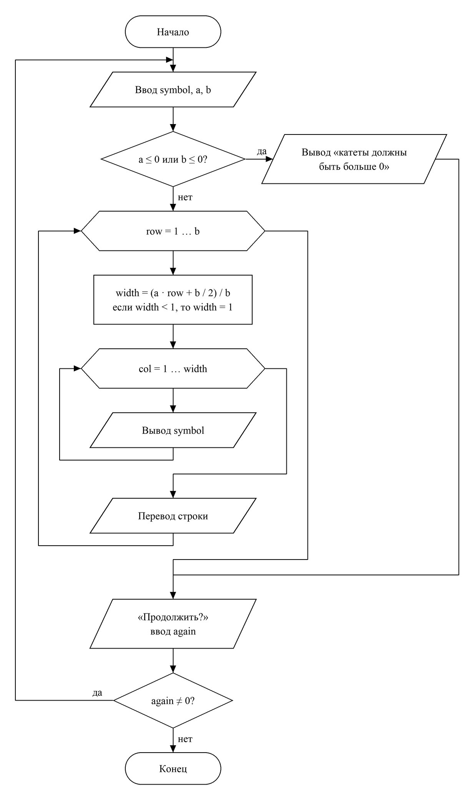

# Домашнее задание к работе №9
Вариант 3

## Условие задачи
Написать программу, выводящую на экран заданную геометрическую фигуру, нарисованную с помощью заданного с клавиатуры символа. Предусмотреть возможность изменения размеров фигуры путем задания ее размеров в количестве символов пользователем.

Вариант 3: **прямоугольный треугольник**, заполнение контура — **да**, задаваемые пользователем параметры — **катеты a, b**.

## 1. Алгоритм и блок-схема
### Алгоритм:
1. Начало.
2. Повторять (цикл do-while):
   - ввести символ **symbol** и катеты **a** (по горизонтали, в символах) и **b** (по вертикали, в строках);
   - если a ≤ 0 или b ≤ 0, вывести сообщение об ошибке;
   - иначе для каждой строки **row** от 1 до b найти ее ширину **width = (a · row + b / 2) / b** (если width < 1, взять 1). Вывести width символов symbol и перевести строку;
   - спросить «Продолжить?» и ввести **again**.
3. Пока **again ≠ 0**, повторять шаг 2.
4. Конец.

### Блок-схема:


## 2. Реализация программы
```c
#define _CRT_SECURE_NO_DEPRECATE
#include <stdio.h>
#include <locale.h>

// Вариант 3
// Закрашенный прямоугольный треугольник с катетами a и b, нарисованный заданным символом
int main() {
    setlocale(LC_CTYPE, "RUS");
    char symbol;
    int a, b;
    int width;
    int again; // ответ на вопрос
    do {
        puts("Символ для рисования:");
        scanf(" %c", &symbol);
        puts("Катет a (по горизонтали, в символах) и катет b (по вертикали, в строках):");
        scanf("%d %d", &a, &b);
        if (a <= 0 || b <= 0)
            puts("Катеты должны быть больше 0");
        else {
            for (int row = 1; row <= b; row++) {
                width = (a * row + b / 2) / b; // округление до целого
                if (width < 1)
                    width = 1;
                for (int col = 1; col <= width; col++)
                    putchar(symbol);
                putchar('\n');
            }
        }
        puts("Продолжить? (Да - любое число, Нет - 0):");
        scanf("%d", &again);
    } while (again != 0);
    return 0;
}
```

## 3. Результаты работы программы

Пример 1. Ввод:
```text
*
10 5
1
#
4 8
0
```
Вывод:
```text
Символ для рисования:
Катет a (по горизонтали, в символах) и катет b (по вертикали, в строках):
**
****
******
********
**********
Продолжить? (Да - любое число, Нет - 0):
Символ для рисования:
Катет a (по горизонтали, в символах) и катет b (по вертикали, в строках):
#
#
##
##
###
###
####
####
Продолжить? (Да - любое число, Нет - 0):
```

Пример 2. Ввод:
```text
+
0 3
0
```
Вывод:
```text
Символ для рисования:
Катет a (по горизонтали, в символах) и катет b (по вертикали, в строках):
Катеты должны быть больше 0
Продолжить? (Да - любое число, Нет - 0):
```

## 4. Информация о разработчике
Головкова Милена Евгеньевна, бТИИ-261
